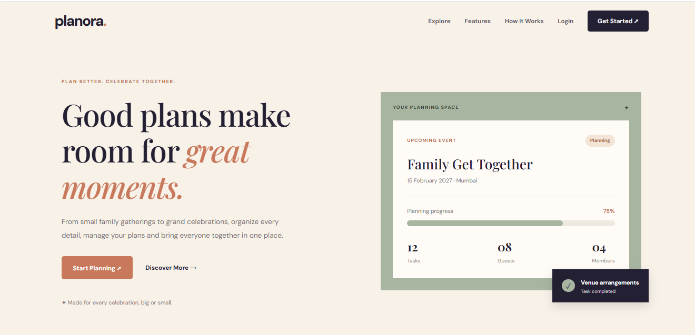
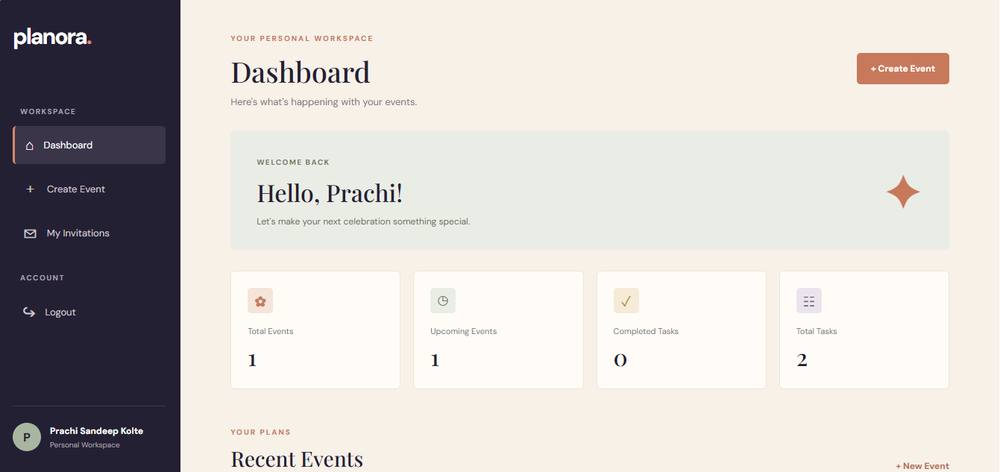
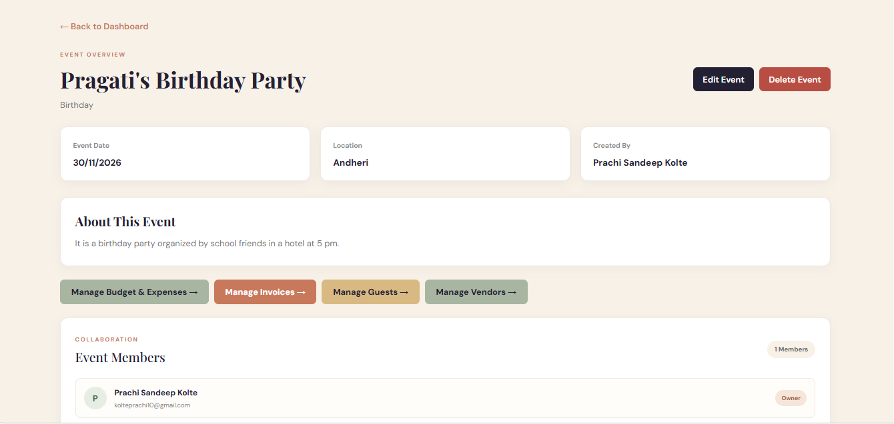
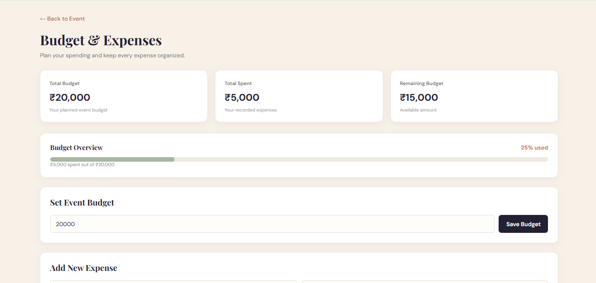
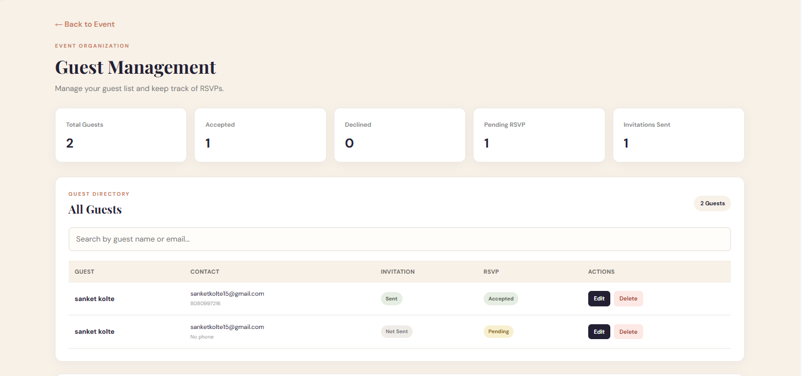
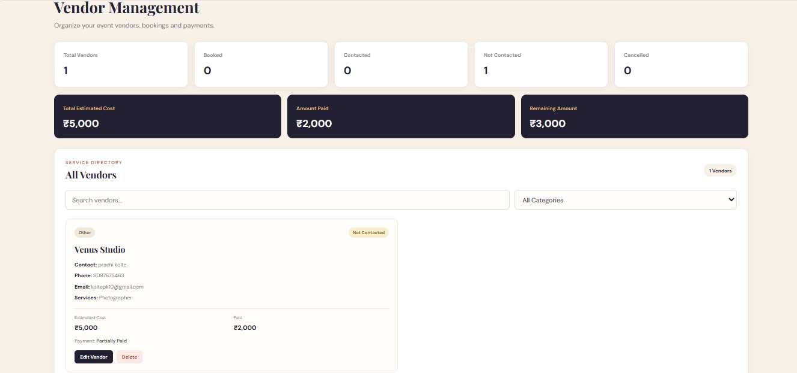

# ✨ Event Management System

A full-stack MERN application designed to simplify event planning and management. Users can create events, organize tasks, manage budgets, track expenses, handle guests and vendors, and collaborate with friends and family through role-based access.

## 📌 About the Project

Planning an event involves managing multiple responsibilities, deadlines, people and expenses. This application brings everything together in one platform, making event organization easier and more efficient.

Whether it is a wedding, birthday, family gathering or college event, users can manage their event activities from a single dashboard.

## 🚀 Features

### 1. Event Management
- Create and manage events.
- Add event title, description, date, location and type.
- Edit and delete events.
- View personal and shared events.

### 2. Tasks & Deadlines
- Create tasks for individual events.
- Set task deadlines and priorities.
- Track task status: Pending, In Progress and Completed.
- Edit and delete tasks.

### 3. Budget & Expenses
- Set an event budget.
- Add, edit and delete expenses.
- Categorize expenses.
- Track total spending and remaining budget.

### 4. Invoice Management
- Create and manage invoices.
- Track total amount and amount paid.
- Monitor pending, partially paid and paid invoices.
- View remaining payment amounts.

### 5. Guest Management
- Add and manage guest details.
- Track invitation status.
- Manage RSVP responses.
- View guest statistics.

### 6. Team Collaboration
- Invite registered users to an event.
- Assign different roles to members.
- Accept or reject invitations.
- Access shared events based on permissions.

**Available Roles:**
- Task Manager
- Finance Manager
- Guest Manager
- Vendor Manager
- Viewer

### 7. Vendor Management
- Add and manage vendor information.
- Organize vendors by service category.
- Track booking status.
- Manage estimated costs and payments.
- Calculate remaining vendor payments.

## 🛠️ Technologies Used

### Frontend
- React.js
- JavaScript
- HTML5
- CSS3
- Axios
- React Router DOM

### Backend
- Node.js
- Express.js
- REST APIs
- JWT Authentication
- bcryptjs

### Database
- MongoDB
- Mongoose

### Development Tools
- Visual Studio Code
- Postman / Thunder Client
- Git & GitHub
- MongoDB Atlas

## 📂 Project Structure

```text
EventManagement/
│
├── backend/
│   ├── models/
│   ├── routes/
│   ├── middleware/
│   ├── server.js
│   └── .env
│
├── frontend/
│   ├── public/
│   └── src/
│       ├── components/
│       ├── pages/
│       ├── styles/
│       ├── api.js
│       ├── App.js
│       └── index.js
│
└── README.md
```

## 📸 Screenshots

### Home Page


### Dashboard


### Event Details


### Budget & Expenses


### Guest Management


### Vendor Management



## ⚙️ Installation & Setup

### Prerequisites
- Node.js
- npm
- MongoDB Atlas account or local MongoDB
- Git

### 1. Clone the Repository

```bash
git clone YOUR_GITHUB_REPOSITORY_URL
```

### 2. Navigate to the Project

```bash
cd EventManagement
```

### 3. Setup Backend

```bash
cd backend
npm install
```

Create a `.env` file inside the backend folder:

```env
MONGO_URI=your_mongodb_connection_string
JWT_SECRET=your_secret_key
PORT=5000
```

Start the backend:

```bash
npm run dev
```

### 4. Setup Frontend

Open another terminal:

```bash
cd frontend
npm install
npm start
```

The application will run at:

- Frontend: http://localhost:3000
- Backend: http://localhost:5000

## 🔐 Authentication & Authorization

- User registration and login.
- Password hashing using bcryptjs.
- JWT-based authentication.
- Protected API routes.
- Role-based access control for shared events.

## 🎯 Project Objectives

- Simplify event planning and organization.
- Provide centralized event management.
- Improve task and deadline tracking.
- Maintain financial records.
- Enable collaboration among event members.
- Provide organized guest and vendor management.

## 🔮 Future Enhancements

- Email notifications and reminders.
- Interactive calendar integration.
- Online payment gateway.
- Real-time chat between event members.
- Automated invitation delivery.

## 👩‍💻 Developed By

**Prachi Kolte**

BSc Information Technology

## 📄 License

This project was developed for educational and portfolio purposes.
